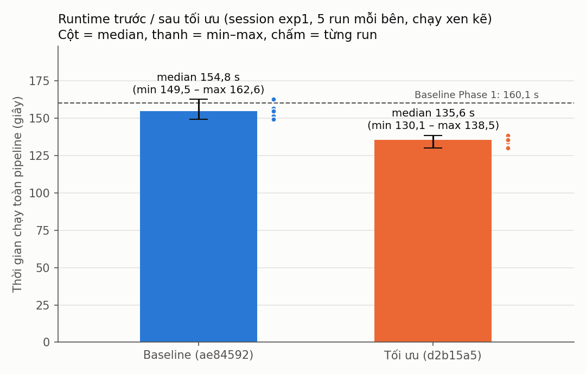
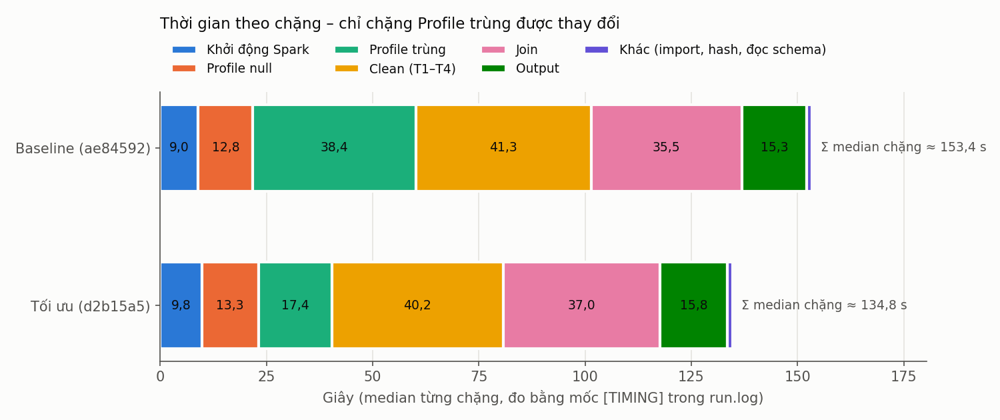
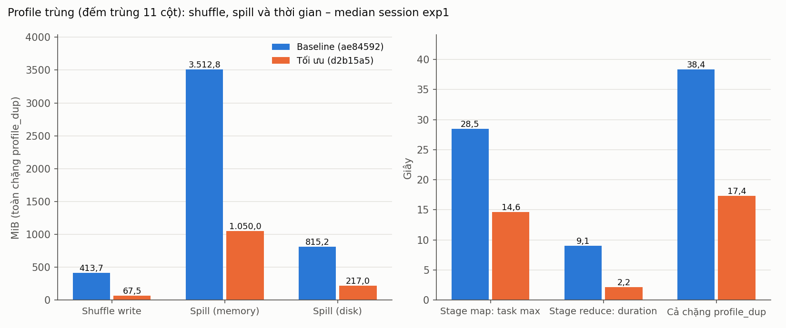

# Báo cáo Checkpoint 4 — Benchmark & tối ưu pipeline

**Nhóm 3** · Baseline commit **`ae84592`** (tag `checkpoint-4-baseline`) · Optimized commit **`d2b15a5`** (tag `checkpoint-4-optimized`)

| Median runtime (exp1) | Speedup | Correctness | Quyết định |
|---|---|---|---|
| 154,751 s → 135,565 s | −12,4 % (1,14×), vượt nhiễu | PASS 283/283 | **KEEP** |

Chi tiết từng bước, từng run: [`experiment-log.md`](../experiment-log.md). Số liệu thô: [`benchmark.csv`](../benchmark.csv),
[`evidence/checkpoint4/`](../evidence/checkpoint4/). Slide: `reports/BigData_DoAn4_Checkpoint4_Report_Nhom3.pptx`.

---

## A. Baseline

**Workload.** PaySim CSV, 1 file 493.534.783 bytes (471,4 MiB), 6.362.620 dòng × 11 cột, SHA-256 `16910f90…4eea6b`, đọc
từ raw zone CP2 qua `metadata/manifest.json`. Pipeline `src/pipeline.py`: đọc schema FAILFAST → profile null + đếm trùng
toàn dòng → T1–T4 → kiểm dimension + left_anti → broadcast left join → groupBy(day_index, type) → Parquet 152 dòng, 10 cột
→ đọc lại đối soát.

**Môi trường.** Windows 11, 8 CPU logic, RAM 7,8 GiB; PySpark 3.5.9, Java 17.0.20, Python 3.12.10; `local[*]`; driver memory
mặc định 1g (JVM heap 1.024 MiB); AQE bật, `shuffle.partitions=200`, `autoBroadcastJoinThreshold=10 MB`. Config khác mặc
định: chỉ có Spark event log (bật ở cả hai phía) và `ui.showConsoleProgress=false`.

**Cách đo.** `src/benchmark.py` chạy pipeline từ git worktree check-out **đúng tag** (input là hard-link của cùng một file
vật lý), mỗi run một tiến trình/JVM mới, 1 warm-up bị loại. Thời gian từng chặng lấy từ mốc `[TIMING]` trong `run.log`;
metric từng stage lấy từ Spark event log (`src/stage_metrics.py`).

**Kết quả baseline** (session `exp1`, 18/11, 5 run, chạy xen kẽ với bản tối ưu): 156,697 / 151,506 / 149,459 / 162,640 /
154,751 s → **median 154,751 s** (min 149,459, max 162,640, stdev 5,104). Output 152 nhóm; 6.362.620 giao dịch; fraud
8.213; tổng tiền 1.144.392.944.759,77.
Phase 1 (17/11, 5 run, session `phase1`): median 160,142 s (156,453–177,613). Dùng để tìm bottleneck, **không** dùng để so
before/after vì đo khác ngày.

## B. Bottleneck evidence

| Chặng (median, Phase 1) | Giây | % runtime |
|---|---:|---:|
| hash SHA-256 | 0,599 | 0,4 % |
| khởi động Spark | 11,049 | 6,9 % |
| profile_null | 11,868 | 7,4 % |
| **profile_dup** | **42,970** | **26,8 %** |
| clean / join / output | 42,009 / 36,621 / 14,797 | 26,2 / 22,9 / 9,2 % |

- **Tách LINEAGE→INPUT (71,9 s ở CP3):** profile_dup chiếm 64,7 %, hash chỉ 1,0 %.
- **Stage nặng nhất là stage 10** (map của profile_dup, `groupBy` 11 cột):
  - 32,9 s ở Phase 1 / 28,5 s ở exp1, so với khoảng 10–12 s cho một lần quét CSV cùng input;
  - shuffle write **413,7 MiB = 6.362.620 record = 100 % số dòng**, vì partial aggregate không gộp được dòng nào;
  - spill 1.768 MiB memory / 406 MiB disk, cộng thêm stage reduce 12: 1.744 / 409 MiB. Đây là **stage duy nhất của pipeline
    bị spill**;
  - peak execution memory khoảng 52 MiB/task (heap 1g chia cho 8 task); 62/62 WARN `RowBasedKeyValueBatch` đều rơi vào khung
    giờ của chặng này.
- **Plan** (`explain_profile_dup.txt`): `Exchange hashpartitioning(step, type, amount, nameOrig, oldbalanceOrg,
  newbalanceOrig, nameDest, oldbalanceDest, newbalanceDest, isFraud, isFlaggedFraud, 200)`. AQE ShuffleQueryStage
  1.358,7 MiB, 6,36E+6 rows.
- **Ứng viên B** (CSV bị parse lặp lại: 12 stage quét/run) có tổng chi phí lớn nhưng rải đều trên hơn 10 job, và cache với
  heap 1g có rủi ro bộ nhớ. Nhóm để B cho Buổi 11.

**Bottleneck claim.** Chúng tôi cho rằng bước đếm trùng toàn dòng (groupBy 11 cột) là bottleneck của chặng profile, vì nó
đẩy toàn bộ 6,36 triệu dòng × 11 cột qua Exchange và là nơi duy nhất trong pipeline bị spill khi mỗi task chỉ có khoảng
52 MiB execution memory.

## C. Hypothesis & change

**Hypothesis.** Nếu profile_dup chậm vì aggregate và shuffle trên khóa 11 cột rộng, thì khi thay khóa bằng `xxhash64(11 cột)`
để tìm ứng viên trùng rồi chỉ kiểm chính xác 11 cột trên các hash ứng viên, chúng tôi kỳ vọng shuffle bytes, spill, task max
và thời gian profile_dup giảm (số record shuffle vẫn là 6.362.620, chỉ kích thước mỗi record giảm), trong khi
`duplicate_groups = duplicate_extra_rows = 0` và mọi business metric giữ nguyên.

**Change** (một thay đổi, chỉ ở `src/quality_report.py` và chỗ gọi trong `src/pipeline.py`; config Spark không đổi):

- *Before:* `groupBy(11 cột).count().filter(count > 1)`.
- *After:*
  - **bước 1:** `groupBy(xxhash64(11 cột)).count().filter(count > 1)` cho ra các hash ứng viên;
  - **nếu rỗng:** 0 trùng, chính xác vì hai dòng giống hệt nhau luôn cùng hash;
  - **nếu khác rỗng:** broadcast các hash, `left_semi` lọc input, rồi `groupBy` đủ 11 cột trên tập con. Va chạm hash chỉ làm
    tăng ứng viên và bị loại ở bước này.

**Expected signal.** Exchange chuyển sang một cột bigint; shuffle write < 413,7 MiB; spill giảm mạnh (lý tưởng là 0); task
max < 28,5 s. Chỉ kết luận về runtime nếu |Δ| > max − min của baseline.

**Control.**
- **Giữ cố định:** input (cùng SHA, cùng file vật lý), dimension, `config.json`, `local[*]`, driver 1g, Spark/Java/Python và
  mọi Spark conf.
- **Quy trình giống nhau:** mỗi bên 1 warm-up + 5 run, chạy xen kẽ B/A trong cùng session `exp1`, mỗi bên chạy từ worktree
  theo tag; event log bật ở cả hai phía.

## D. Before / After (session `exp1`, median 5 run)

| Metric | Baseline | After | Δ | Vượt nhiễu? |
|---|---:|---:|---:|---|
| Runtime median (min–max) | 154,751 (149,459–162,640) s | 135,565 (130,144–138,536) s | −19,186 s (−12,4 %) | Có: > max−min 13,181 s (≈ 3,8 × stdev) |
| sec_profile_dup | 38,364 s | 17,366 s | −20,998 s (−54,7 %) | Có: ≈ 14,5 × stdev 1,443 s |
| Shuffle read / write (cả run) | 413,8 / 413,8 MiB | 67,6 / 67,6 MiB | −83,7 % (record: 6.362.620 ở cả hai) | byte cố định |
| Spill memory / disk (cả run) | 3.512,8 / 815,2 MiB | 1.050,0 / 217,0 MiB | −70,1 % / −73,4 % | byte cố định |
| Max task time (stage 10) | 28,502 s | 14,609 s | −13,893 s (−48,7 %) | Có |
| Output rows | 152 | 152 | 0 | |
| Business metric | fraud 8.213; tổng tiền 1.144.392.944.759,77 | giống hệt | 0 | |

Các chặng không bị sửa (khởi động Spark, profile_null, clean, join, output) đều đổi trong khoảng nhiễu (|Δ| ≤ 1,5 s,
nhỏ hơn max − min của từng chặng). Mức giảm runtime khớp với mức giảm của profile_dup.

**Plan trước–sau:** Exchange đổi từ `hashpartitioning(11 cột, 200)` sang `hashpartitioning(xxhash64(...) AS
_groupingexpression, 200)`. Kích thước ShuffleQueryStage theo AQE giảm từ 1.358,7 MiB xuống 145,6 MiB, cùng
rowCount 6,36E+6. Bản tối ưu không còn Exchange thứ hai (SinglePartition), và số job mỗi run giảm 46 → 45 vì bước 2
không chạy.

**Hypothesis đúng một phần:** spill **không về 0**, còn 1.050 MiB memory / 217 MiB disk. Partial aggregate vẫn phải giữ
khoảng 795 nghìn khóa mỗi task trong khoảng 42–52 MiB execution memory (suy luận, chưa đo riêng).

## E. Correctness

`python src/check_correctness.py --session exp1` → **PASS 283/283** (`evidence/checkpoint4/exp1/correctness.json`), trên
cả 12 run exp1, so với run baseline tham chiếu:

- **Row count:** input 6.362.620 → valid 6.362.620 → after join 6.362.620; unmatched 0; invalid 0.
- **Profile:** null 0, duplicate_groups 0, duplicate_extra_rows 0, amount = 0 là 16 dòng. Ở bản tối ưu `hash_candidates = 0`.
- **Business:** fraud 8.213; tổng tiền 1.144.392.944.759,77; 152 nhóm; khóa (day_index, type) duy nhất.
- **Schema:** 10 cột, giống hệt `schema_output.txt` của baseline.
- **Checksum:** sort theo (day_index, type) rồi so từng ô: 0 khác biệt. SHA-256 của các dòng đã sort (`dfe6a121…`) giống
  nhau ở 12/12 run; exceptAll 2 chiều 0/0; `compare_runs.py` → RERUN PASS.
- **Kiểm trùng mới vẫn chính xác** (`tests/test_dup_check.py`, 5/5 PASS):
  - chèn 1 dòng trùng vào mẫu 1.000 dòng → (1, 1) giống cách cũ;
  - ca va chạm xxhash64 thật (khác dòng nhưng cùng hash) → 0 trùng;
  - ca hỗn hợp cặp trùng / cặp gần trùng / dòng lặp 3 lần → (2, 3).

## F. Decision

**KEEP.**
- Δ runtime −19,186 s (−12,4 %) lớn hơn biên độ max − min của baseline trong cùng session (13,181 s), và hai khoảng
  min–max không chồng nhau.
- Mức giảm nằm đúng ở chặng bị nhắm tới (−21,0 s, khoảng 14,5 × stdev).
- Metric cố định theo byte xác nhận cơ chế: shuffle −83,7 %, spill −70–73 %, Exchange trên bigint.
- Output giống hệt từng ô.

**Hạn chế.**
- Một máy Windows, `local[*]`, heap 1g; một file 471 MiB.
- Warm-up đã bị loại (máy khởi động lại trước exp1); RAM trống 2,2–2,9 GiB; IDE mở ở cả hai phía.
- File dim CRLF trong worktree: cùng byte ở hai phía, output không đổi.
- Phase 1 và exp1 đo ở hai ngày khác nhau. Δ −19,2 s nhỏ hơn biên độ 21,16 s của Phase 1, nên before/after **chỉ** lấy
  từ exp1.
- Mỗi phía chỉ có 5 run.

**Nếu data tăng 10×?** *(suy luận, chưa đo)* Giải pháp vẫn hợp lý, có thể còn lợi hơn. Cách cũ phải shuffle 11 cột cho
khoảng 63,6 triệu dòng, cách mới chỉ một bigint cộng count mỗi dòng. Va chạm hash vẫn hiếm (khoảng 10⁻⁴), và bước 2 đảm bảo
kết quả đúng. Hai giới hạn:
- số record shuffle vẫn tăng tuyến tính, và spill còn nếu không tăng bộ nhớ;
- nếu có nhiều dòng trùng thật, không nên collect hash ứng viên về driver.

Ngoài ra, chi phí parse CSV lặp lại sẽ thành phần trội.

**Nếu speedup < variance?** Không được kết luận "nhanh hơn", chỉ ghi "không phát hiện khác biệt ở cấp runtime". Metric
byte (shuffle, spill, plan) vẫn là bằng chứng về cơ chế. Muốn kết luận cần thêm run hoặc giảm nhiễu.

**Next action.**
- **Buổi 11:** chuyển input CSV → Parquet (Data Lake). Hiện vẫn còn 12 stage parse CSV mỗi run; clean + join + output khoảng
  93 s ở bản tối ưu. Đánh giá bằng đúng quy trình này.
- **Experiment riêng:** driver memory (1g → lớn hơn), để xem spill còn lại có hết không.
